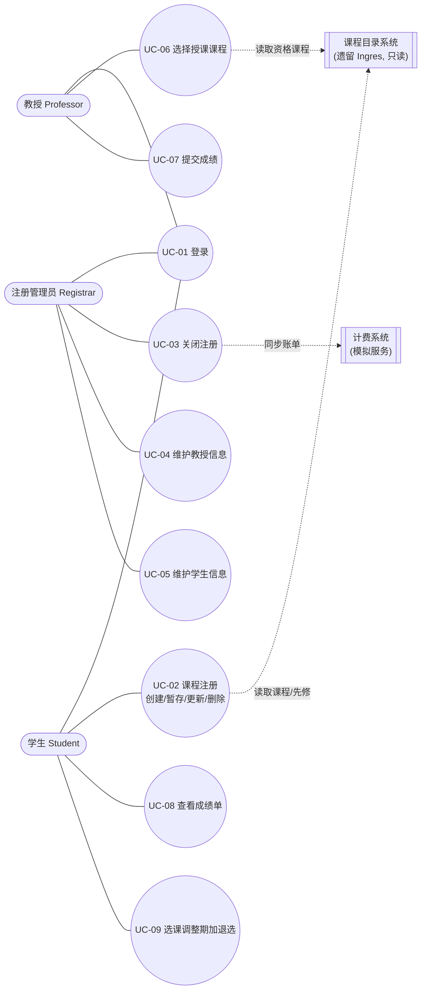
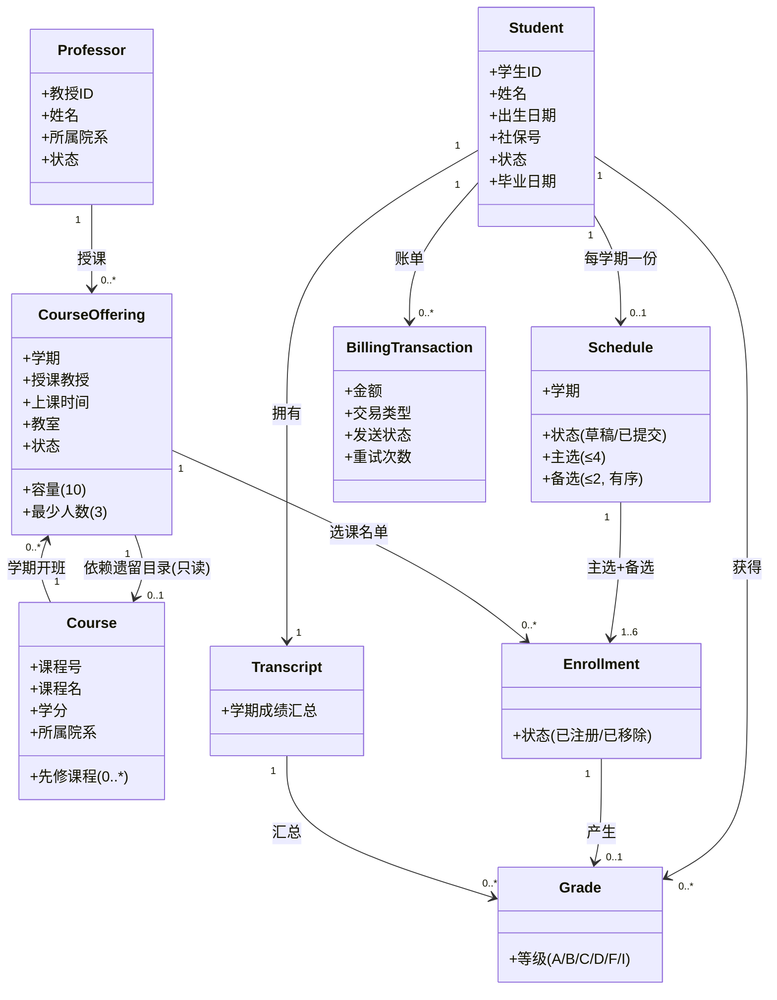

# 学生选课注册系统 需求分析文档

**项目名称**：学生选课注册系统（Wylie College Course Registration System）
**文档版本**：V1.0（2026-10-15 定稿）
**编写**：成员C　**评审**：成员A（组长）、全组

---

## 1 引言

### 1.1 编写目的
本文档定义学生选课注册系统的**功能需求**与**非功能需求**，作为设计、实现、测试与验收的共同依据。
文档面向：开发组成员、课程设计评审教师、运行检查现场评委。

### 1.2 需求来源
- 《2026 Software Engineering Practice Project》（题目原文，含问题陈述、术语表、补充规格、设计约束、用例模型）。
- 课程设计要求中的交付物清单（开发计划、需求分析、设计文档、测试计划、测试报告、工作总结）。
- 工作区提供的 UML 类图截图（`屏幕截图 2026-10-10 133324.png`），用于校准领域概念与职责划分。

### 1.3 术语与缩写
| 术语 | 定义 |
|------|------|
| 课程（Course） | 大学开设的教学科目，如 CS101「程序设计基础」 |
| 课程班 / 开课（Course Offering） | 某课程在某学期的具体开班形式，含授课教授、上课时间、教室、容量；同一课程可并行开设多个班 |
| 课程目录（Course Catalog） | 全校课程的完整目录，存放在遗留库中，新系统只读 |
| 课表（Schedule） | 学生某学期选定的课程集合，由若干课表项（主选/备选）构成 |
| 主选课程（Primary） | 学生计划注册的核心课程，至多 4 门 |
| 备选课程（Backup） | 主选无法选入时按顺序启用的替补课程，至多 2 门，有明确顺序 |
| 选课名单（Roster） | 注册某课程班的全体学生列表 |
| 成绩（Grade） | 学生在某课程班的学业评价，取值 A/B/C/D/F/I（I 为未完成） |
| 成绩单（Report Card） | 学生单个学期所有修读课程的成绩汇总 |
| 学业记录（Transcript） | 学生历学期成绩的历史记录，同步至财务系统用于计费 |
| 计费系统（Billing System） | 处理账单信息的外部系统，本项目以本机模拟服务替代 |
| 注册管理员（Registrar） | 负责学生/教授信息维护与关闭学期注册的教务角色 |
| 遗留系统（Legacy System） | 运行在 DEC VAX 上的 Ingres 课程目录数据库 |

---

## 2 系统概述

### 2.1 业务背景
学院现役注册系统基于大型机技术，需替换为支持校园局域网个人电脑访问的新系统。受经费限制，
课程目录数据库保留在遗留平台（DEC VAX + Ingres），通过开放 SQL 接口从 Unix 服务器访问；新系统
**仅读取**课程信息，不做任何修改（课程信息由注册办公室通过其他系统维护）。

### 2.2 用户与角色
| 角色 | 描述 | 主要职责 |
|------|------|----------|
| 学生（Student） | 在校注册修读课程的人员 | 登录、课程注册（创建/暂存/更新/删除课表）、调整期加退选、查看成绩单 |
| 教授（Professor） | 承担授课工作的人员 | 登录、选择授课课程、查看选课名单、提交成绩 |
| 注册管理员（Registrar） | 教务管理人员 | 登录、维护学生信息、维护教授信息、关闭注册 |
| 遗留课程目录系统 | 外部系统 | 提供课程、先修关系、教授授课资格数据（只读） |
| 计费系统 | 外部系统 | 接收学期账单交易，生成学生账单 |

### 2.3 设计约束
1. 必须与现有遗留课程目录系统（关系型数据库）集成，且**只读**。
2. 系统需提供基于 Windows 平台的桌面交互界面（本项目实现为符合 Windows 95/98 交互规范的 Web 界面）。
3. 遗留库访问响应时间不超过 10 秒；原型验证表明不通过中间层优化无法满足性能要求。
4. 不使用 Docker、Redis、消息队列：缓存采用进程内 Caffeine，异步重试采用进程内定时任务。

### 2.4 假设与依赖
- 遗留库通过开放 SQL 接口可访问；本机以独立数据库 `legacy_catalog` + 只读账号模拟该接口。
- 财务系统提供"发送账单"接口；本机以模拟服务替代，可切换可用/不可用用于演示重试。
- 学期对象由注册办公室预先配置；每学期设置一个"当前学期"标志与一个选课调整期窗口。

---

## 3 业务规则

### 3.1 核心业务规则（源自题目）
| 编号 | 规则 | 说明与判定条件 |
|------|------|----------------|
| BR-1 | 每学期初，学生可获取本学期课程目录 | 目录内容含授课教授、所属院系、先修课程、上课时间、容量等；数据来自遗留库，只读 |
| BR-2 | 学生可选 4 门主选课程，同时填报 2 门备选课程 | 备选按填报顺序启用：主选无法选入时，依次尝试备选 1、备选 2 |
| BR-3 | 单门课程班最多 10 人、最少 3 人 | 选课时人数已达 10 则拒绝并**实时通知学生**；选课结束后人数不足 3 人的课程班**取消** |
| BR-4 | 每学期设置选课调整期，学生可在此期间加退选 | 调整期以学期配置的起止日期为准；调整期内的加退选产生**差额计费** |
| BR-5 | 注册完成后系统将选课信息同步至计费系统生成学期账单 | 学费 = Σ(已注册课程学分) × 每学分单价（默认 500 元/学分）；计费不可用时按固定周期重试 |
| BR-6 | 学期末学生可在线查看电子成绩单，成绩数据需做安全防护 | 学生只能查看**本人**成绩单；成绩写入仅限授课教授 |
| BR-7 | 教授可在线申请授课、查看选课名单、录入所授课程的学生成绩 | 教授只能从**具备授课资格**的课程中选择，且授课时间不得冲突 |

### 3.2 派生业务规则（实现层细化）
| 编号 | 规则 | 来源 |
|------|------|------|
| BR-8 | 学生提交课表前必须完成先修课程校验；未通过则拒绝提交并提示缺失的先修课 | BR-1、BR-2 |
| BR-9 | 课表内课程不得存在时间冲突（同一天时段重叠），主选与备选均参与冲突检测 | BR-2 |
| BR-10 | 注册关闭后，学生不可再选课或调整课表；教授不可再调整授课安排 | BR-4、BR-5 的时点约束 |
| BR-11 | 成绩等级仅允许 A/B/C/D/F/I，允许留空（表示未录入），允许后续补录与修改 | BR-7 |
| BR-12 | 教授只能为**上一学期**自己所授课程班录入成绩；本学期课程班不允许录入 | BR-7 |
| BR-13 | 学生仅可修改本人课表；教授仅可修改自己所授课程班；仅注册管理员可修改学生/教授基础信息 | 补充规格 3.6 |
| BR-14 | 学生 ID、教授 ID 由系统生成且唯一；对不存在 ID 的更新/删除请求必须报错且状态不变 | 用例 5.4/5.5 |
| BR-15 | 删除学生/教授信息必须经过二次确认；确认环节取消则不做任何变更 | 用例 5.4/5.5 |

---

## 4 用例模型

### 4.1 参与者与用例总览
| 参与者 | 用例 |
|--------|------|
| 学生 | UC-01 登录、UC-02 课程注册、UC-09 选课调整期加退选（扩展）、UC-08 查看成绩单 |
| 教授 | UC-01 登录、UC-06 选择授课课程、UC-07 提交成绩 |
| 注册管理员 | UC-01 登录、UC-03 关闭注册、UC-04 维护教授信息、UC-05 维护学生信息 |
| 外部系统 | 课程目录系统（UC-02/UC-06 数据来源）、计费系统（UC-03 下游） |

> 题目用例模型共 8 个用例（UC-01 ~ UC-08）。UC-09 是依据业务规则 BR-4（选课调整期）
> 派生的扩展用例，在本系统中作为独立用例实现并验收。

### 4.2 用例详述

#### UC-01 登录（Login）
| 项 | 内容 |
|----|------|
| 参与者 | 学生、教授、注册管理员 |
| 简要说明 | 用户以用户名与口令登录，系统按角色进入对应工作台 |
| 前置条件 | 账号已存在且状态正常 |
| 后置条件 | 成功则获得访问令牌并进入角色首页；失败则状态不变 |

**基本流程**
1. 用户输入用户名与口令，提交登录请求。
2. 系统校验账号存在性、口令正确性与账号状态。
3. 系统签发访问令牌，返回角色、姓名与当前学期信息，前端跳转至该角色首页。

**备选流程**
- **口令错误 / 账号不存在**：提示"用户名或密码错误，请重新输入"，允许重试。
- **越权访问**：已登录用户访问非本角色接口时，系统返回 403 并提示无权操作。

#### UC-02 课程注册（Register for Courses）
| 项 | 内容 |
|----|------|
| 参与者 | 学生（主）、课程目录系统（辅） |
| 简要说明 | 学生获取本学期课程目录，创建/修改/删除课表；支持暂存未提交的课表 |
| 前置条件 | 学生已登录；本学期注册处于开放状态 |
| 后置条件 | 成功则课表保存并（提交时）写入选课记录；失败则状态不变 |

**基本流程**
1. 学生进入选课工作台，系统从遗留课程目录获取课程信息并展示可选课程班列表
   （含授课教授、院系、先修课、时间、容量与已选人数）。
2. 学生选择至多 4 门主选课程与至多 2 门备选课程（备选有顺序）。
3. 学生提交课表，系统执行校验：
   - 先修要求满足；
   - 目标课程班处于开放状态且未选满（已选人数 < 10）；
   - 课表内课程（含备选）无时间冲突。
4. 校验通过后，系统将学生加入对应课程班并标记「已注册」，课表状态置为「已提交」。

**备选流程**
- **暂存课表**：学生可暂存课表，课表项标记为「已选择」，**不占用课程班名额**。
- **更新课表**：展示当前课表与可选课程，学生增删课程后重新校验并保存。
- **删除课表**：二次确认后删除课表，并同步将学生从对应课程班移除。
- **先修课不足**：拒绝提交，指出缺失的先修课程；学生可更换课程、暂存或取消。
- **课程已满**：**在学生提交课表前实时通知**"课程已满"，并说明已在主选中的课程情况，
  建议启用备选课程。
- **时间冲突**：指出冲突的两门课程，学生调整后重试。
- **课程目录不可用**：提示"课程目录系统暂时不可用"，**终止用例**。
- **注册已关闭**：提示后终止用例。

#### UC-03 关闭注册（Close Registration）
| 项 | 内容 |
|----|------|
| 参与者 | 注册管理员（主）、计费系统（辅） |
| 简要说明 | 管理员执行关闭学期注册：自动取消人数不足或未分配教授的课程班，按顺序启用备选课程，
| | 计算学费并同步至计费系统 |
| 前置条件 | 管理员已登录；本学期注册处于开放状态 |
| 后置条件 | 学期状态置为「已关闭」；课程班最终名单确定；账单交易登记并（尽力）发送 |

**基本流程**
1. 管理员发起关闭注册请求，系统校验学期注册状态为开放。
2. 系统取消**未分配授课教授**的课程班。
3. 系统取消**选课人数少于 3 人**的课程班，并移除相关选课记录与课表关联。
4. 系统对受影响的学生**按备选顺序**尝试补位：备选课程班若仍开放且未满、且满足先修与
   时间冲突校验，则将其提升为「已注册」。
5. 系统再次检查各课程班人数：**补位后仍不足 3 人的课程班继续取消**（循环至稳定）。
6. 系统按学生已注册课程的学分计算学费（Σ学分 × 500 元），生成计费交易并同步至计费系统。
7. 系统输出关闭注册执行报告：取消的课程班及原因、备选补位成功/失败明细、被移除的课表项、
   计费交易笔数与总金额。

**备选流程**
- **重复关闭**：本学期注册已关闭时，直接拒绝并提示"无需重复执行"。
- **计费系统不可用**：交易落库为「发送失败」，**按固定周期（默认 30 秒）自动重试直至成功**，
  重试过程与结果可在计费监控页查看，并提供手动重试入口。

#### UC-04 维护教授信息（Maintain Professor Information）
| 项 | 内容 |
|----|------|
| 参与者 | 注册管理员 |
| 简要说明 | 管理员对教授信息进行新增、修改、删除 |
| 前置条件 | 管理员已登录 |
| 后置条件 | 成功则教授信息变更；失败则状态不变 |

**基本流程**
1. 管理员选择操作类型：新增 / 更新 / 删除。
2. **新增**：录入姓名、出生日期、社保号、状态、所属院系；系统生成唯一教授 ID 并保存，返回 ID。
3. **更新**：输入教授 ID，系统查询并展示信息；修改后提交，系统更新记录。
4. **删除**：输入教授 ID，系统查询并展示信息；**二次确认**后删除记录。

**备选流程**
- **教授不存在**：更新/删除时 ID 无效，提示错误，可重新输入或取消。
- **取消删除**：删除确认环节取消，回到主流程，不做任何变更。

#### UC-05 维护学生信息（Maintain Student Information）
| 项 | 内容 |
|----|------|
| 参与者 | 注册管理员 |
| 简要说明 | 管理员对学生信息进行新增、修改、删除 |
| 前置条件 | 管理员已登录 |
| 后置条件 | 成功则学生信息变更；失败则状态不变 |

**基本流程**
1. 管理员选择操作类型：新增 / 更新 / 删除。
2. **新增**：录入姓名、出生日期、社保号、状态、毕业日期；系统生成唯一学生 ID 并保存。
3. **更新**：输入学生 ID，查询展示后修改提交。
4. **删除**：输入学生 ID，查询展示后**二次确认**删除。

**备选流程**
- **学生不存在**：更新/删除时 ID 无效，提示错误后重新输入或取消。
- **取消删除**：删除确认环节取消，状态不变。

#### UC-06 选择授课课程（Select Courses to Teach）
| 项 | 内容 |
|----|------|
| 参与者 | 教授（主）、课程目录系统（辅） |
| 简要说明 | 教授从具备授课资格的课程中，选择本学期希望教授的课程班 |
| 前置条件 | 教授已登录；本学期注册未关闭 |
| 后置条件 | 成功则课程班的授课教授被更新；失败则状态不变 |

**基本流程**
1. 系统展示教授**具备授课资格**的课程列表，以及本学期各课程班与教授已选授课课程班。
2. 教授勾选/取消勾选目标课程班。
3. 系统校验授课时间无冲突后，更新课程班的授课教授信息。

**备选流程**
- **无可用课程**：无授课资格课程时提示错误，确认后终止。
- **时间冲突**：标注冲突课程，教授调整选择或取消。
- **课程班已被其他教授选择**：拒绝并提示。
- **课程目录不可用**：提示"课程目录系统暂时不可用"，**终止用例**。
- **注册已关闭**：提示后终止用例。

#### UC-07 提交成绩（Submit Grades）
| 项 | 内容 |
|----|------|
| 参与者 | 教授 |
| 简要说明 | 教授为**上一学期**自己所授课程班的学生录入成绩，支持留空与后续修改 |
| 前置条件 | 教授已登录，且上一学期有授课记录 |
| 后置条件 | 成功则学生成绩更新；失败则状态不变 |

**基本流程**
1. 系统展示教授上一学期所授的全部课程班。
2. 教授选择目标课程班，系统展示选课学生名单与已录入成绩。
3. 教授为学生录入成绩（A/B/C/D/F/I），允许留空表示未录入；提交后系统保存。
4. 教授可再次进入该课程班修改已录入成绩。

**备选流程**
- **无上学期授课记录**：提示错误，确认后终止用例。
- **非法成绩等级**：拒绝保存并提示仅支持 A/B/C/D/F/I 或留空。
- **学生不在名单中**：拒绝录入并提示。
- **越权**：教授试图录入非本人所授课程班的成绩时，返回 403。

#### UC-08 查看成绩单（View Report Card）
| 项 | 内容 |
|----|------|
| 参与者 | 学生 |
| 简要说明 | 学生查看**上一学期**本人的成绩单 |
| 前置条件 | 学生已登录 |
| 后置条件 | 系统状态无变化 |

**基本流程**
1. 学生请求查看成绩单。
2. 系统查询该学生上一学期所有修读课程的成绩并展示（课程号、课程名、学分、授课教授、成绩）。

**备选流程**
- **无成绩数据**：提示"上一学期没有成绩数据"，确认后结束用例。
- **越权**：学生只能查看本人成绩单，无法通过参数查看他人数据。

#### UC-09 选课调整期加退选（扩展用例）
| 项 | 内容 |
|----|------|
| 参与者 | 学生 |
| 简要说明 | 在学期配置的选课调整期窗口内，学生对已提交课表进行加课与退课，产生**差额计费** |
| 前置条件 | 学生已登录；本学期注册**已关闭**（即名单已确定）；当前日期落在调整期起止之间 |
| 后置条件 | 课表与选课记录同步更新；差额计费交易登记 |

**基本流程**
1. 学生进入"我的课表"，系统展示调整期提示与当前课表。
2. **加课**：学生选择未满员、开放且无冲突的课程班加选；系统校验后写入并标记「已注册」。
3. **退课**：学生选择已注册课程退选；系统将其课表项与选课记录置为已移除。
4. 系统按学分差额生成计费交易（加课为正差额、退课为负差额）。

**备选流程**
- **不在调整期**：提示"当前不在选课调整期内，不能加退选"，终止操作。
- **注册尚未关闭**：提示应直接在选课页面调整（调整期加退选以名单确定为前提）。
- **加课超限/课程已满/时间冲突/已选过该课程**：拒绝并给出具体原因。

---

## 5 补充规格（非功能需求）

| 类别 | 需求 | 验证方式 |
|------|------|----------|
| 功能通用 | 支持多用户并发执行选课、注册、录入等业务操作 | `tools/perf-test.mjs` 并发实测 + 数据库连接池与事务隔离设计 |
| 功能通用 | 选课过程中课程班已满员时，必须**实时通知**学生 | 端到端走查：选满课程后提交，界面立即弹出"课程已满"提示 |
| 易用性 | 桌面用户界面需符合 Windows 95/98 交互规范 | 界面走查：窗口/标题栏/按钮/菜单/任务栏/弹窗风格与中文文案 |
| 可靠性 | 系统 7×24 可用，年度停机时间占比不超过 10% | 架构说明：无状态服务 + 连接池 + 外部依赖降级（缓存兜底、计费重试） |
| 性能 | 最高支持 2000 用户同时访问中央数据库、500 用户同时访问本地服务器 | 50/100/200 并发实测 + 外推分析与本机瓶颈说明（见测试报告） |
| 性能 | 遗留库访问响应时间 ≤ 10 秒 | `tools/legacy-compare.mjs`：直连约 8 秒（满足 ≤10s）；缓存 < 200ms |
| 性能 | 80% 的业务事务需在 2 分钟内处理完成 | 性能脚本统计 P50/P95 事务耗时 |
| 安全性 | 学生仅可修改本人课表；教授仅可修改本人所授课程班信息 | 越权用例：跨角色/跨用户访问返回 403 |
| 安全性 | 仅教授具备成绩录入权限 | 管理员/学生调用成绩接口返回 403 |
| 安全性 | 仅注册管理员可修改学生/教授基础信息 | 学生/教授调用维护接口返回 403 |
| 安全性 | 成绩数据需做安全防护 | 成绩单接口按登录身份过滤，仅返回本人数据；无越权参数入口 |
| 可维护性 | 遗留目录访问模式可切换、缓存可刷新、计费可用性可切换 | `/api/system/*` 演示开关 |

---

## 6 领域模型（需求视角）

下图描述需求层面的核心概念与关系，不含实现细节（实现映射见《设计文档》类图与 ER 图）。

---

## 7 需求优先级与追溯矩阵

| 优先级 | 需求 | 用例 | 验收剧本编号（见 README） | 对应测试 |
|--------|------|------|---------------------------|----------|
| P0 | BR-1 课程目录获取 | UC-02、UC-06 | 6、10 | `ScheduleServiceTest`、`ProfessorServiceTest` |
| P0 | BR-2 主选 4 + 备选 2 及顺序补位 | UC-02、UC-03 | 8、13 | `ScheduleServiceTest`、`CloseRegistrationServiceTest` |
| P0 | BR-3 容量 10 / 最少 3 / 满员实时通知 | UC-02、UC-03 | 9、13 | `ScheduleServiceTest`、`CloseRegistrationServiceTest` |
| P0 | BR-4 调整期加退选与差额计费 | UC-09 | 12 | `ScheduleServiceTest`、`BillingServiceTest` |
| P0 | BR-5 学费计算与计费同步、失败重试 | UC-03 | 14、15 | `CloseRegistrationServiceTest`、`BillingServiceTest` |
| P0 | BR-6 成绩单与数据安全 | UC-08 | 17 | `ReportCardTest` |
| P0 | BR-7 选择授课、名单、成绩录入 | UC-06、UC-07 | 10、11、16 | `ProfessorServiceTest` |
| P0 | 登录与角色权限隔离 | UC-01 | 1、2、3、18 | `AuthApiTest` |
| P1 | 学生信息维护（唯一 ID、CRUD、二次确认） | UC-05 | 4、5 | `RegistrarServiceTest` |
| P1 | 教授信息维护 | UC-04 | 5 | `RegistrarServiceTest` |
| P1 | 课程目录不可用时终止用例 | UC-02、UC-06 | 12（目录不可用分支） | `ScheduleServiceTest` |
| P2 | 缓存刷新、模式切换、计费开关等运维入口 | — | 19、20 | 手工走查 |

---

## 8 需求变更记录

| 版本 | 日期 | 变更内容 | 原因 | 影响 |
|------|------|----------|------|------|
| V0.9 | 2026-09-13 | 依据题目完成用例模型与补充规格梳理 | 需求澄清 | — |
| V0.95 | 2026-09-20 | 增加 UC-09 选课调整期加退选用例；明确差额计费 | 业务规则 BR-4 需独立验收 | 设计文档增加调整期时序；测试计划增加用例 |
| V1.0 | 2026-10-15 | 补充追溯矩阵与性能指标验证方式；明确演示开关需求 | 定稿与运行检查准备 | 接口文档增加 `/api/system/*` 章节 |