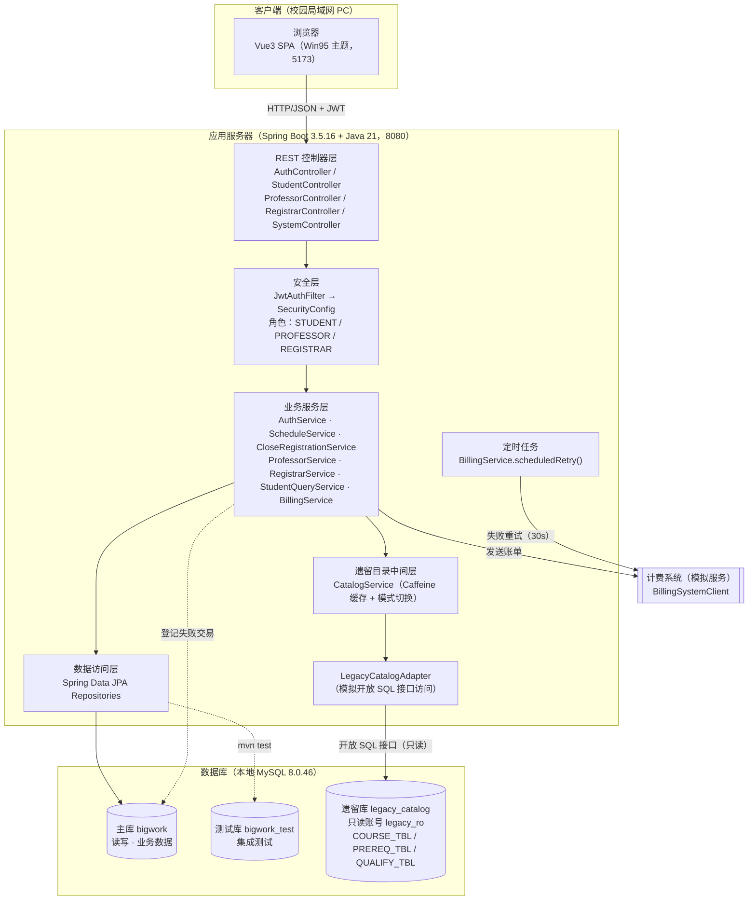
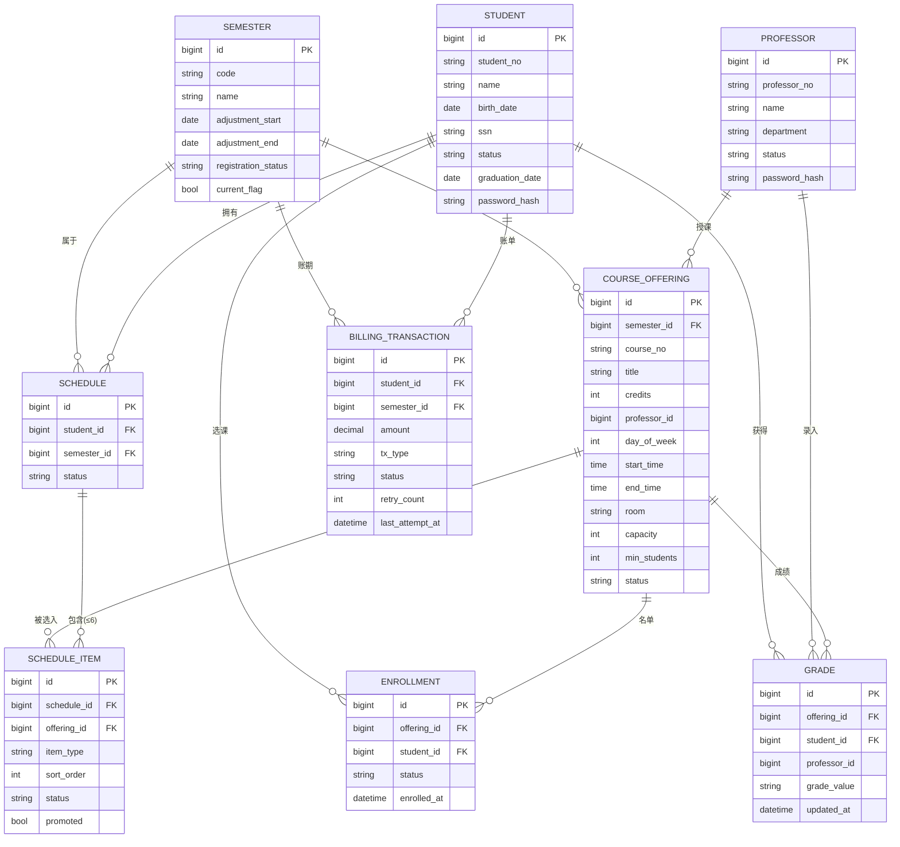
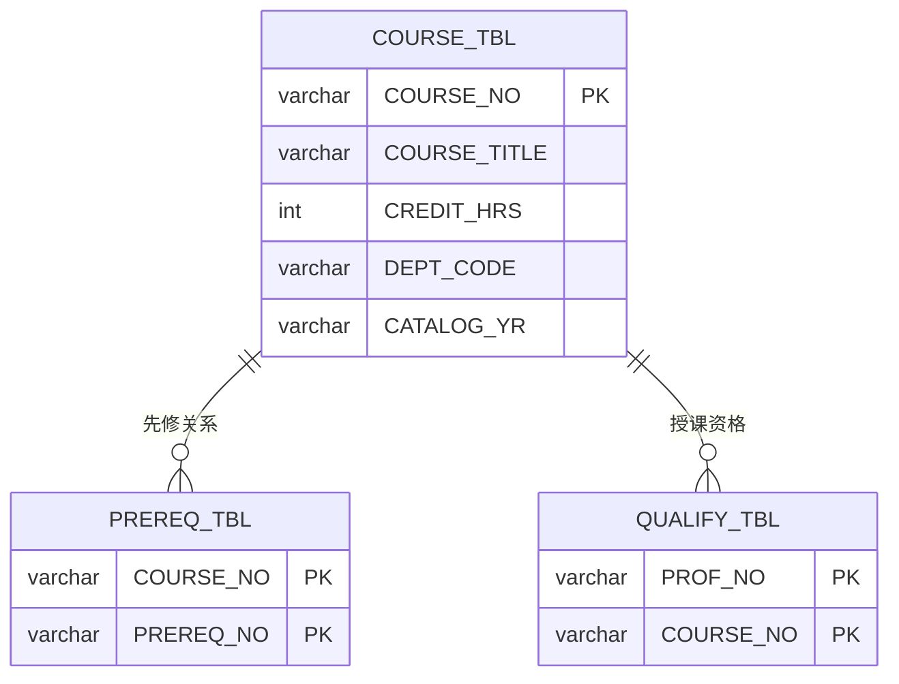
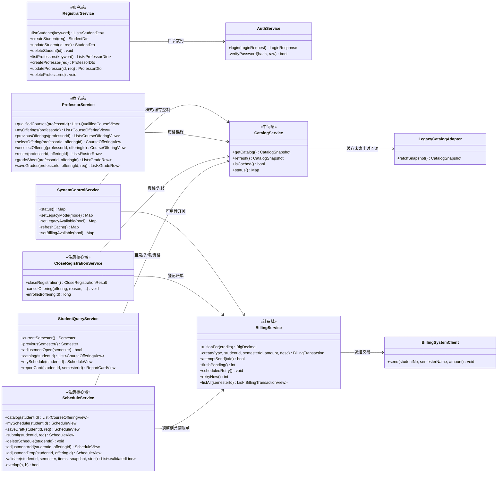
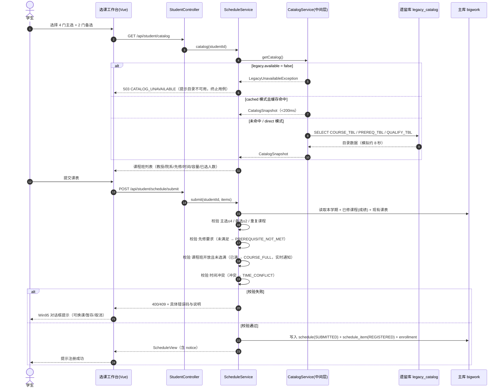
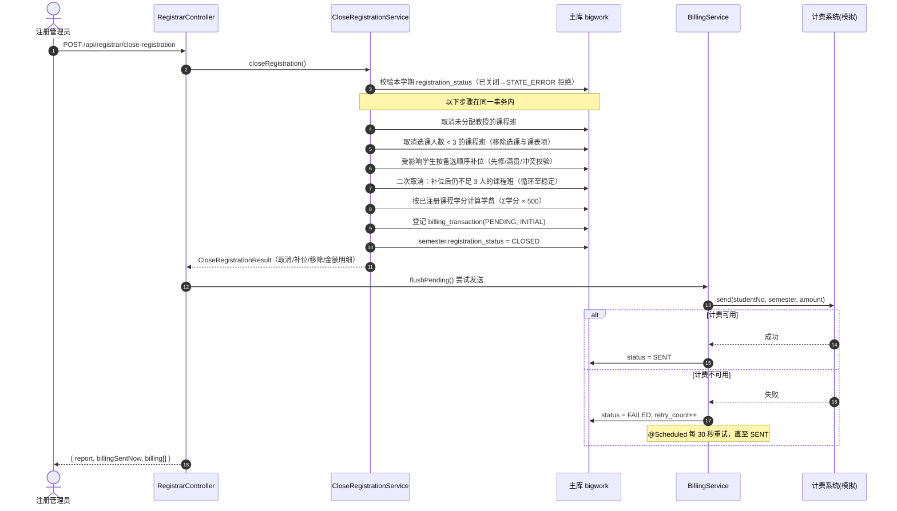
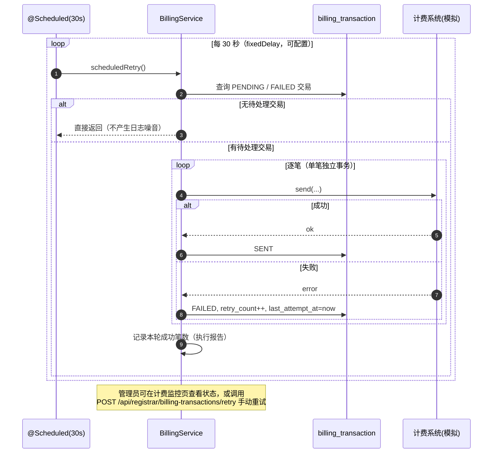

# 学生选课注册系统 设计文档

**项目名称**：学生选课注册系统（Wylie College Course Registration System）
**文档版本**：V1.0（2026-10-15 定稿）
**编写**：成员A（组长）　**评审**：全组
**UML 基准**：本文档的类设计以工作区 UML 类图截图（`屏幕截图 2026-10-10 133324.png`）为基准细化，
图中的 Student / Professor / Registrar / Course / CourseOffering / CourseCatalogSystem / Schedule /
Grade / Transcript / BillingSystem 概念全部落到实现实体与服务上（映射关系见 4.3）。

---

## 1 设计目标与原则

| 目标 | 对应需求 | 设计手段 |
|------|----------|----------|
| 覆盖全部 8 个用例 + 调整期扩展用例 | UC-01 ~ UC-09 | 按模块域切分服务层，用例与控制器/服务一一可追溯 |
| 遗留目录访问 ≤ 10 秒，且不能拖垮并发 | 补充规格 3.5 | **中间层缓存（方案 A）**：Caffeine + 启动预热 + 手动刷新，直连模式保留用于对比 |
| 计费系统不可用时业务不中断 | UC-03 备选流程 | **交易登记与发送解耦** + 定时重试（默认 30 秒）至成功 |
| 成绩等敏感数据安全 | 补充规格 3.6 | 无状态 JWT + 方法级角色鉴权 + 服务层归属校验（越权 403） |
| 7×24 可用 | 补充规格 3.4 | 外部依赖降级（缓存兜底）、批量操作单事务、失败可重试、配置可热切换 |
| 桌面级交互体验 | 补充规格 3.3 | 自研 Win95 主题组件库（窗口/按钮/菜单/表格/弹窗/任务栏） |

**设计原则**：单一职责的分层结构；跨域只暴露少量显式接口；所有业务错误走统一错误码；
批量业务（关闭注册）保证单事务原子性；对外部系统（遗留库、计费）一律设置可用性开关与降级路径。

---

## 2 总体架构

### 2.1 分层架构图

### 2.2 部署视图

| 组件 | 进程/端口 | 说明 |
|------|-----------|------|
| 前端 SPA | Node（开发服务器）`http://localhost:5173` | `vite.config.js` 将 `/api` 反向代理至 8080，避免跨域 |
| 后端服务 | Spring Boot 内嵌 Tomcat `http://localhost:8080` | 无状态；Hikari 连接池最大 30（主库） |
| 主数据库 | MySQL 8.0.46 服务 `MySQL80`，库 `bigwork` | 应用账号 `bigwork_app` |
| 测试数据库 | 同一 MySQL 实例，库 `bigwork_test` | 结构与主库一致，供 `mvn test` 使用 |
| 遗留数据库 | 同一实例，库 `legacy_catalog` | 账号 `legacy_ro` 仅授予 `SELECT`，**物理保证不可写** |

> 部署为本机单机形态：不使用 Docker、Redis、消息队列。缓存为进程内 Caffeine，
> 异步重试为进程内 `@Scheduled`。这一取舍牺牲了水平扩展能力，换取"零额外中间件、可现场启动"，
> 与课程设计"本机运行检查"的验收方式匹配。

---

## 3 数据设计

### 3.1 主库表清单（bigwork，10 张表）

| 表 | 说明 | 关键字段 | 责任人 |
|----|------|----------|--------|
| `semester` | 学期，含注册状态与选课调整期 | `registration_status`(OPEN/CLOSED)、`adjustment_start/end`、`current_flag` | A |
| `student` | 学生信息 + 口令散列 | `student_no`(唯一)、`status`、`graduation_date`、`password_hash` | C |
| `professor` | 教授信息 + 口令散列 | `professor_no`(唯一)、`department`、`status` | C |
| `registrar` | 注册管理员账号 | `username`(唯一) | C |
| `course_offering` | 课程班（开课） | `course_no`(来自遗留目录)、`credits`、`professor_id`(可空)、`day_of_week/start_time/end_time/room`、`capacity`(10)、`min_students`(3)、`status` | A |
| `schedule` | 学生课表（每生每学期一份） | `status`(DRAFT/SUBMITTED) | A |
| `schedule_item` | 课表项：主选/备选 + 顺序 + 状态 | `item_type`(PRIMARY/BACKUP)、`sort_order`、`status`(SELECTED/REGISTERED/REMOVED)、`promoted` | A |
| `enrollment` | 选课记录（课程班名单来源） | `status`(REGISTERED/DROPPED) | A |
| `grade` | 成绩 | `grade_value`(A/B/C/D/F/I，可空)、`professor_id`(录入人) | A |
| `billing_transaction` | 计费交易（登记与发送解耦） | `amount`(正数应收/负数退费)、`tx_type`(INITIAL/ADJUSTMENT)、`status`(PENDING/SENT/FAILED)、`retry_count`、`last_attempt_at` | D |

### 3.2 ER 图（主库）

> `GRADE` 与 `SCHEDULE_ITEM` 均通过 `(offering_id, student_id)` 与选课关系对齐；成绩仅在
> 课程班确定名单后由授课教授写入。

### 3.3 遗留库结构（legacy_catalog，老式命名）

设计要点：
- **无外键、全大写列名、字符主键**——刻意模拟 DEC VAX/Ingres 遗留库的物理风格。
- 通过**独立数据源**（`LegacyDataSourceConfig`，`legacyJdbcTemplate`）+ **只读账号** `legacy_ro`
  访问；账号仅有 `SELECT` 权限，因此"新系统不修改遗留数据"这一约束由数据库权限**物理保证**，
  而不仅靠代码自律。
- 中间层一次拉取形成 `CatalogSnapshot`（课程 + 先修 + 资格），在应用侧完成关系拼装，
  避免每次业务校验都回源遗留库。

---

## 4 类设计

### 4.1 后端类图（实现视图）

### 4.2 前端结构

| 层次 | 文件 | 职责 |
|------|------|------|
| 主题 | `src/styles/win95.css` | Win95 视觉规范：桌面、窗口、标题栏、按钮、菜单栏、表格、选项卡、状态栏、对话框、任务栏 |
| 组件 | `src/components/Win95*.vue` | `Win95Window`、`Win95Button`、`Win95Table`、`Win95MenuBar`、`Win95Dialog`、`Win95Taskbar` |
| 状态 | `src/stores/auth.js`、`src/stores/ui.js` | 登录态与角色；Promise 风格的 alert/confirm/choose 弹窗（二次确认即由此实现） |
| 路由 | `src/router/index.js` | hash 路由 + 角色守卫，每个角色独立首页与子页面 |
| 接口 | `src/api/http.js`、`src/api/index.js` | Axios 实例（自动附带 JWT）、401 广播事件、按域分组的 API 封装 |
| 页面 | `src/views/**` | 学生端（选课工作台/我的课表/成绩单）、教授端（选授课/选课名单/成绩录入）、管理员端（学生管理/教授管理/关闭注册/计费监控）、系统演示面板 |

### 4.3 UML 截图概念 → 实现映射

| UML 截图中的类 | 实现载体 | 说明 |
|----------------|----------|------|
| Student | `student` 表 + `Student` 实体 + `StudentQueryService` | 属性：姓名/出生日期/社保号/状态/毕业日期 + 学号 |
| Professor | `professor` 表 + `Professor` 实体 + `ProfessorService` | 属性：姓名/院系/状态 + 教授编号 |
| Registrar | `registrar` 表 + `Registrar` 实体 + `RegistrarService` | 维护学生/教授信息、关闭注册 |
| Course | 遗留库 `COURSE_TBL` + `LegacyCourse` record | 课程号/名称/学分/院系，只读 |
| CourseOffering | `course_offering` 表 + `CourseOffering` 实体 + `CourseOfferingView` | 授课教授、时间、教室、容量、状态 |
| CourseCatalogSystem | `CatalogService` + `LegacyCatalogAdapter` | 目录获取与缓存，对应"外部系统"参与者 |
| Schedule | `schedule` + `schedule_item` + `ScheduleView` | 主选/备选、顺序、状态 |
| Grade | `grade` 表 + `GradeValue` 枚举 + `RosterRow`/`GradeRow` | 录入与修改，取值受约束 |
| Transcript | `ReportCardView` + `StudentQueryService.reportCard` | 学期成绩单视图（按学生+学期聚合） |
| BillingSystem | `BillingSystemClient` + `BillingService` + `billing_transaction` | 发送账单、失败重试、执行报告 |

---

## 5 关键设计决策

### 5.1 D-01 遗留课程目录：采用中间层缓存（方案 A）
**问题**：原型验证表明，直连遗留库无法满足性能要求（本地模拟单次约 8000 ms，且并发时被
连接与 IO 放大）。**方案对比**：

| 方案 | 说明 | 结论 |
|------|------|------|
| 直连（direct） | 每次业务请求实时访问遗留库 | 响应约 8 秒，仅勉强满足"≤10 秒"底线；并发下不可接受 |
| 数据同步（ETL） | 定期把遗留目录复制到主库 | 违背"课程信息仍由注册办公室维护、新系统只读"的语义，且引入同步一致性风险 |
| **中间层缓存（选定）** | 应用侧中间层一次拉取快照，进程内缓存 + TTL + 预热 + 手动刷新 | 缓存命中 < 200 ms；保留 direct 模式用于对比与降级 |

**实现**：`CatalogService` 读取 `legacy.mode`（`cached`/`direct`）：
- `cached`：`Caffeine` 缓存（TTL 默认 600 秒，`legacy.cache-ttl-seconds`），未命中才回源；
  **启动预热**（`ApplicationRunner`）避免首个用户等待 8 秒；提供 `/api/system/cache/refresh` 手动刷新。
- `direct`：每次 `adapter.fetchSnapshot()`，用于现场演示"未优化"的对比基线。
- `legacy.available=false` 时抛 `LegacyUnavailableException`（`CATALOG_UNAVAILABLE`，
  HTTP 503），用于演示"课程目录不可用则终止用例"。
- 缓存一致性策略：课程目录由第三方系统低频维护，采用**TTL 到期 + 手动刷新**的弱一致策略，
  在文档与界面（演示面板）中明示快照时间与加载耗时，便于运行检查时解释取舍。

### 5.2 D-02 双数据源与主数据源显式声明
主库与遗留库需在同一进程内并存，且主库必须参与 JPA 事务、遗留库只做只读查询：
- `DataSourceConfig` 用 `@Primary` 显式声明主数据源（`dataSource`）与 `JdbcTemplate`，
  避免 Spring Boot 单数据源自动配置在"存在第二个 `DataSource` Bean"时产生歧义。
- `LegacyDataSourceConfig` 声明 `legacyDataSource` 与 `legacyJdbcTemplate`（`@Qualifier` 注入）。
- 遗留库访问**不加入**主库事务，避免慢查询拖住业务事务（关闭注册等批量事务中不访问遗留库，
  而是使用启动时/请求时已缓存的 `CatalogSnapshot`）。

### 5.3 D-03 批量操作单事务 + 备选补位收敛
"关闭注册"是破坏性批量操作，必须**单事务**：状态校验 → 取消无教授/人数不足的班级 →
课表按备选顺序补位 → 二次取消（补位后仍不足 3 人） → 计算学费并登记计费交易 →
将学期置为 CLOSED。任何一步异常整体回滚，学期状态保持开放，可安全重试。

补位与取消存在相互影响（补位可能救活一个班，取消又可能让另一个班跌破阈值），因此采用
**循环至稳定**的实现：反复扫描 CONFIRMED 课程班，取消 `人数 < 3` 者，直到一轮扫描无变化
（上限 5 轮防止逻辑缺陷导致死循环）；补位时同样执行先修、满员、时间冲突校验，
失败则记录为"补位失败"并写入执行报告，而不是静默丢弃。

### 5.4 D-04 计费解耦与失败重试状态机
**问题**：计费系统可能不可用，但关闭注册不能因此失败或长时间阻塞。
**决策**：把"登记交易"与"发送交易"分离：关闭注册事务内只**登记** `PENDING` 交易；
事务提交后立即尝试发送（`flushPending`）；失败则标记 `FAILED` 并累加 `retry_count`，
由 `@Scheduled(fixedDelay=30s)` 周期扫描 `PENDING/FAILED` 交易重试，直至 `SENT`。
`attemptSend` 单笔独立事务，一笔失败不影响其他笔；管理员可在计费监控页查看重试次数、
最近尝试时间与失败原因，并可手动触发一次重试。

### 5.5 状态机

**学期 / 注册状态**

| 当前状态 | 事件 | 目标状态 | 说明 |
|----------|------|----------|------|
| OPEN | 管理员关闭注册 | CLOSED | 单事务完成取消、补位、计费登记 |
| CLOSED | 再次关闭注册 | CLOSED（拒绝） | 返回 `STATE_ERROR`：无需重复执行 |
| CLOSED + 当前时间 ∈ 调整期 | 学生加/退选 | CLOSED | 生成差额计费交易（`ADJUSTMENT`） |

**课表项状态（schedule_item.status）**

| 当前状态 | 事件 | 目标状态 |
|----------|------|----------|
| — | 学生暂存课表 | `SELECTED`（不占用名额） |
| `SELECTED` | 学生提交且校验通过 | `REGISTERED`（占用名额，写入 enrollment） |
| `SELECTED` / `REGISTERED` | 学生退课或课表被删除 | `REMOVED` |
| `SELECTED`（备选） | 关闭注册时按序补位成功 | `REGISTERED`（`promoted=true`） |
| `REGISTERED` | 所在课程班被取消（人数不足/无教授） | `REMOVED` |

**课程班状态（offering.status）**：`PROPOSED`（待确认，未分配教授或未生效）→ `CONFIRMED`（已生效，
可被选课）→ `CANCELLED`（关闭注册时被取消）。

**计费交易状态（billing_transaction.status）**

| 当前状态 | 事件 | 目标状态 |
|----------|------|----------|
| — | 关闭注册/调整期差额登记 | `PENDING` |
| `PENDING` | 发送成功 | `SENT` |
| `PENDING` | 发送失败（计费不可用） | `FAILED`（`retry_count++`） |
| `FAILED` | 定时重试（30s）或手动重试成功 | `SENT` |
| `FAILED` | 重试仍失败 | `FAILED`（继续累积，直至成功） |

**成绩**：`NULL`（未录入）↔ `A/B/C/D/F/I`，允许留空与反复修改；仅授课教授可写，
且仅限**上一学期**课程班。

---

## 6 关键时序

### 6.1 学生提交课表（含先修/满员/冲突/目录不可用分支）

### 6.2 关闭注册（UC-03 全流程）

### 6.3 计费失败自动重试

---

## 7 安全设计

| 关注点 | 设计 |
|--------|------|
| 认证 | `POST /api/auth/login` 校验口令散列（BCrypt），签发 JWT（对称密钥，默认有效期 720 分钟）；`JwtAuthFilter` 解析并构造 `AuthUser`（id/role/name/username） |
| 会话 | 全程无状态（`SessionCreationPolicy.STATELESS`），不落服务端会话，便于并发与重启 |
| 授权 | 粗粒度：`SecurityConfig` 按路径放行登录与只读状态接口，其余需认证；细粒度：控制器类级 `@PreAuthorize("hasRole('...')")`，服务层再做**归属校验**（教授只能操作自己所授课程班；学生只能操作本人课表与成绩单） |
| 数据隔离 | 所有学生接口从 `AuthUser.current().id()` 取当前用户，**不接收学生 ID 作为参数**，从接口形态上消除越权入口；成绩单同理 |
| 遗留库只读 | 独立账号 `legacy_ro` 仅授 `SELECT`，物理保证不可写 |
| 统一拒绝 | 未认证 → 401 `UNAUTHORIZED`；已认证无权 → 403 `FORBIDDEN`；两者均返回 JSON 错误体，前端 401 广播事件统一跳回登录页 |
| 审计线索 | 计费交易保留 `retry_count`、`last_attempt_at`、`description`；成绩保留录入教授与更新时间 |
| 口令存储 | 数据库仅存 BCrypt 散列，脚本内种子账号口令为演示用固定口令（`123456`/`admin123`），README 明示仅供本机演示 |

---

## 8 性能设计

| 指标（补充规格） | 设计应对 | 验证 |
|------------------|----------|------|
| 遗留库访问 ≤ 10 秒 | 中间层缓存（命中 < 200 ms）；未命中时单次回源约 8 s，仍在阈值内；启动预热避免首次等待 | `tools/legacy-compare.mjs` |
| 2000 用户并发访问中央数据库 / 500 并发访问本地服务器 | 无状态服务 + Hikari 连接池（最大 30）+ 短事务 + 必要的唯一约束；缓存承担目录读流量，避免把并发压力传导给遗留库 | 50/100/200 并发实测 + 外推分析 |
| 80% 事务 ≤ 2 分钟 | 批量操作（关闭注册）单事务但不访问遗留库（使用已缓存快照）；列表接口只读、无 N+1 查询 | 性能脚本事务耗时统计 |
| 满员实时通知 | 提交校验在读事务内即时判定并返回 `COURSE_FULL`，前端以模态对话框实时提示 | 端到端走查 |

**已知瓶颈与说明**：本机为单机开发环境（单 JVM、单 MySQL 实例、无集群），实测并发上限受
CPU 核数、连接池与 MySQL 单实例吞吐限制，因此测试报告以 200 并发实测为基线，
对 2000 并发做线性/次线性外推，并明确标注"外推值非实测值"。

---

## 9 界面设计（Win95/98 规范）

| 元素 | 设计 |
|------|------|
| 桌面 | 浅青桌面背景 + 桌面图标（按角色显示可用入口），窗口可层叠 |
| 窗口 | 灰色立体边框（外凸），蓝色渐变标题栏 + 最小化/最大化/关闭按钮，标题栏文字为当前页面名 |
| 菜单栏 | 顶部菜单（文件/操作/帮助式结构），支持下拉项与选中态 |
| 控件 | 3D 按钮（按下时内凹）、分组框、文本输入框、下拉框、单选/复选 |
| 表格 | 单元格有明确边框线、表头凸起、斑马纹可选，支持行选中高亮；列表为空时显示"无数据"提示 |
| 对话框 | 模态窗口 + 图标（信息/警告/错误）+ 确定/取消；**删除操作必须二次确认**；`alert/confirm/choose` 由 `stores/ui.js` 以 Promise 形式提供 |
| 任务栏 | 底部任务栏含"开始"按钮与已打开页面按钮，显示当前角色与时间 |
| 文案 | 全中文；错误提示使用可操作的语言（说明原因 + 下一步建议） |

---

## 10 设计评审与变更记录

| 版本 | 日期 | 内容 | 评审结论 |
|------|------|------|----------|
| V0.9 | 2026-09-20 | 架构图、类图、ER 图、库表设计、接口清单 | 通过；要求补充"目录不可用"分支时序与补位收敛说明 |
| V0.95 | 2026-10-06 | 补充选课/关闭注册/计费重试时序；确定方案 A 中间层 | 通过；要求把 `direct` 模式保留为演示对比路径 |
| V1.0 | 2026-10-15 | 补充状态机、安全与性能设计、UML 映射表 | 通过（定稿） |