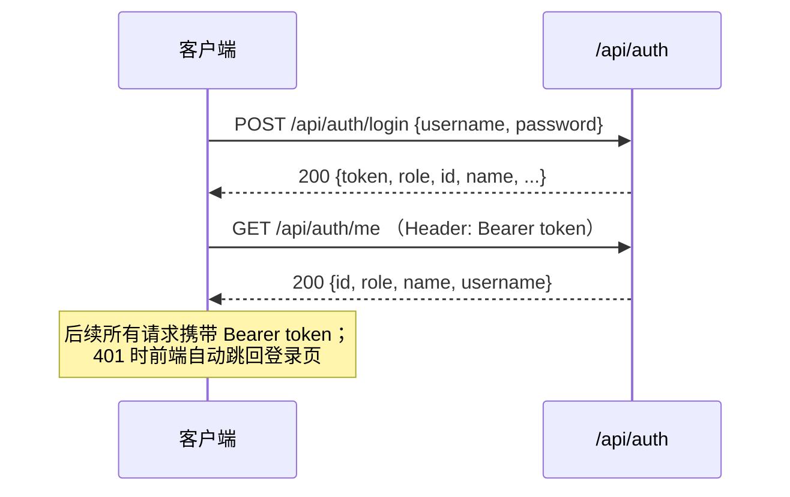

# 学生选课注册系统 接口文档

**文档版本**：V1.0（2026-10-15 定稿）　**编写**：成员A（组长）　**评审**：全组
**变更同步**：任何接口变更必须同步本文件（见《程序代码规范》10.2 自检清单）

---

## 1 通用约定

| 项 | 说明 |
|----|------|
| 服务地址 | 后端 `http://localhost:8080`；前端开发服务器 `http://localhost:5173` 将 `/api` 代理到后端 |
| 数据格式 | 请求与响应均为 JSON（`application/json; charset=UTF-8`） |
| 认证方式 | 除登录与只读状态接口外，均需 `Authorization: Bearer <JWT>` |
| 令牌有效期 | 默认 720 分钟（`jwt.expire-minutes`） |
| 角色 | `STUDENT`（学生）、`PROFESSOR`（教授）、`REGISTRAR`（注册管理员） |
| 成功响应 | 200 + 业务数据；删除类操作返回 `{ "code": "OK", "message": "..." }` |
| 失败响应 | `{ "code": "<错误码>", "message": "<中文说明>" }`，HTTP 状态见第 7 节 |
| 日期时间 | 日期 `yyyy-MM-dd`；时刻 `HH:mm`；时间戳 ISO-8601 字符串 |

### 1.1 认证流程


### 1.2 接口一览
| # | 方法 | 路径 | 权限 | 说明 |
|---|------|------|------|------|
| 1 | POST | `/api/auth/login` | 公开 | 登录 |
| 2 | GET | `/api/auth/me` | 已登录 | 当前登录信息 |
| 3 | GET | `/api/semesters` | 已登录（全角色） | 学期列表（迭代 2，用于各页面学期切换） |
| 4 | GET | `/api/student/catalog` | STUDENT | 本学期可选课程目录 |
| 5 | GET | `/api/student/schedule` | STUDENT | 我的课表（`?semesterId` 可查历史学期，缺省=当前；历史学期无选课计划行时按已注册课程只读回退） |
| 6 | POST | `/api/student/schedule/draft` | STUDENT | 暂存课表 |
| 7 | POST | `/api/student/schedule/submit` | STUDENT | 提交课表（完整校验） |
| 8 | DELETE | `/api/student/schedule` | STUDENT | 删除课表 |
| 9 | POST | `/api/student/adjustment/add/{offeringId}` | STUDENT | 调整期加课 |
| 10 | POST | `/api/student/adjustment/drop/{offeringId}` | STUDENT | 调整期退课 |
| 11 | GET | `/api/student/report-card` | STUDENT | 查看成绩单（`?semesterId`，缺省=上一学期） |
| 12 | GET | `/api/student/transcript` | STUDENT | 学业记录（迭代 2，按学期分组 + GPA） |
| 13 | GET | `/api/student/billing-transactions` | STUDENT | 我的账单（迭代 2，`?semesterId` 可筛选） |
| 14 | GET | `/api/professor/qualified-courses` | PROFESSOR | 具备资格的课程 + 课程班 |
| 15 | GET | `/api/professor/offerings` | PROFESSOR | 我在指定学期的授课课程班（`?semesterId`，缺省=当前） |
| 16 | POST | `/api/professor/offerings/{id}/select` | PROFESSOR | 选择授课 |
| 17 | DELETE | `/api/professor/offerings/{id}/select` | PROFESSOR | 取消授课 |
| 18 | GET | `/api/professor/offerings/{id}/roster` | PROFESSOR | 查看选课名单 |
| 19 | GET | `/api/professor/offerings/{id}/grades` | PROFESSOR | 成绩表（可录入学期） |
| 20 | PUT | `/api/professor/offerings/{id}/grades` | PROFESSOR | 录入/修改成绩 |
| 21 | GET | `/api/registrar/students` | REGISTRAR | 学生列表（可检索，前端每页 20 条） |
| 22 | POST | `/api/registrar/students` | REGISTRAR | 新增学生 |
| 23 | PUT | `/api/registrar/students/{id}` | REGISTRAR | 修改学生 |
| 24 | DELETE | `/api/registrar/students/{id}` | REGISTRAR | 删除学生（前端二次确认） |
| 25 | GET | `/api/registrar/professors` | REGISTRAR | 教授列表（可检索，前端每页 20 条） |
| 26 | POST | `/api/registrar/professors` | REGISTRAR | 新增教授 |
| 27 | PUT | `/api/registrar/professors/{id}` | REGISTRAR | 修改教授 |
| 28 | DELETE | `/api/registrar/professors/{id}` | REGISTRAR | 删除教授（前端二次确认） |
| 29 | POST | `/api/registrar/semesters` | REGISTRAR | 新建学期（迭代 2） |
| 30 | PUT | `/api/registrar/semesters/{id}` | REGISTRAR | 编辑学期 / 重新开启注册（迭代 2） |
| 31 | POST | `/api/registrar/semesters/{id}/set-current` | REGISTRAR | 设为当前学期（迭代 2） |
| 32 | GET | `/api/registrar/courses` | REGISTRAR | 遗留课程目录（开班下拉，迭代 2） |
| 33 | GET | `/api/registrar/offerings` | REGISTRAR | 指定学期课程班列表（迭代 2） |
| 34 | POST | `/api/registrar/offerings` | REGISTRAR | 新建课程班（开班，迭代 2） |
| 35 | PUT | `/api/registrar/offerings/{id}` | REGISTRAR | 编辑课程班（迭代 2） |
| 36 | DELETE | `/api/registrar/offerings/{id}` | REGISTRAR | 删除课程班（引用保护，迭代 2） |
| 37 | POST | `/api/registrar/close-registration` | REGISTRAR | 关闭注册（批量） |
| 38 | GET | `/api/registrar/billing-transactions` | REGISTRAR | 计费交易与重试状态（`?semesterId` 可筛选） |
| 39 | POST | `/api/registrar/billing-transactions/retry` | REGISTRAR | 手动触发重试 |
| 40 | GET | `/api/system/status` | 公开 | 遗留目录/计费/学期状态 |
| 41 | POST | `/api/system/legacy-mode` | REGISTRAR | 切换 direct/cached |
| 42 | POST | `/api/system/legacy-availability` | REGISTRAR | 切换目录可用性 |
| 43 | POST | `/api/system/cache/refresh` | REGISTRAR | 刷新目录缓存 |
| 44 | POST | `/api/system/billing-availability` | REGISTRAR | 切换计费可用性 |
| 45 | GET | `/actuator/health` | 公开 | 健康检查 |

---

## 2 认证接口

### 2.1 登录
`POST /api/auth/login`　权限：公开

请求体：
```json
{ "username": "2026001", "password": "123456" }
```
响应 200：
```json
{
  "token": "eyJhbGciOiJIUzI1NiJ9...",
  "role": "STUDENT",
  "id": 1,
  "name": "陈晓",
  "username": "2026001",
  "currentSemesterId": 2,
  "currentSemesterName": "2026-2027学年第一学期",
  "registrationStatus": "OPEN"
}
```
失败：401 `UNAUTHORIZED`（"用户名或密码错误，请重新输入"）。

> 演示账号：学生 `2026001`~`2026016`、教授 `P001`~`P005`，口令均为 `123456`；
> 注册管理员 `registrar`，口令 `admin123`。

### 2.2 当前登录信息
`GET /api/auth/me`　权限：已登录
```json
{ "id": 1, "role": "STUDENT", "name": "陈晓", "username": "2026001" }
```

---

## 3 学生接口（STUDENT）

### 3.1 获取本学期课程目录
`GET /api/student/catalog`

响应 200（数组，元素为 `CourseOfferingView`）：
```json
[
  {
    "offeringId": 1,
    "courseNo": "CS101",
    "title": "程序设计基础",
    "credits": 4,
    "department": "计算机科学与技术",
    "professorId": 1,
    "professorName": "张伟",
    "dayOfWeek": 1,
    "dayText": "周一",
    "startTime": "08:00",
    "endTime": "09:40",
    "room": "A101",
    "capacity": 10,
    "enrolledCount": 5,
    "full": false,
    "status": "CONFIRMED",
    "prerequisiteTitles": [],
    "timeText": "周一 08:00-09:40"
  }
]
```
失败：503 `CATALOG_UNAVAILABLE`（课程目录系统不可用，用例终止）。
其中 `full=true` 表示已满员（`enrolledCount >= capacity`），前端在选课时即给出满员提示。

### 3.2 我的课表
`GET /api/student/schedule`（可选查询参数 `semesterId`，缺省取当前学期；历史学期用于只读查看：非当前学期若无选课计划行，则按该学期已注册课程回退生成只读视图，`status=HISTORY`、条目 `itemType=PRIMARY`/`status=REGISTERED`、`itemId` 为空）
```json
{
  "scheduleId": 1,
  "status": "SUBMITTED",
  "semesterId": 2,
  "semesterName": "2026-2027学年第一学期",
  "registrationStatus": "OPEN",
  "adjustmentOpen": false,
  "adjustmentWindow": "2026-10-01 ~ 2027-01-15",
  "items": [
    {
      "itemId": 1,
      "itemType": "PRIMARY",
      "sortOrder": 1,
      "status": "REGISTERED",
      "promoted": false,
      "offering": { "offeringId": 1, "courseNo": "CS101", "title": "程序设计基础", "timeText": "周一 08:00-09:40", "...": "（同 3.1）" }
    }
  ],
  "notice": null
}
```
说明：`itemType` 为 `PRIMARY`（主选，最多 4）/ `BACKUP`（备选，最多 2，按 `sortOrder` 顺序启用）；
`status` 为 `SELECTED`（已选择，暂存未占名额）/ `REGISTERED`（已注册）/ `REMOVED`（已移除）；
`promoted=true` 表示该备选在关闭注册时被补位提升。

### 3.3 暂存课表
`POST /api/student/schedule/draft`　权限：STUDENT

请求体（`items` 为主选与备选混合列表，`itemType` 决定类型）：
```json
{
  "items": [
    { "offeringId": 1, "itemType": "PRIMARY" },
    { "offeringId": 2, "itemType": "PRIMARY" },
    { "offeringId": 5, "itemType": "BACKUP" }
  ]
}
```
响应 200：同 3.2 的 `ScheduleView`（课表状态为 `DRAFT`）。
说明：暂存**不占用课程班名额**，但仍执行先修、时间冲突、数量上限等校验。
失败：400 `VALIDATION`（如"主选课程最多 4 门"/"备选课程最多 2 门"/"请至少选择 1 门主选课程"）、
409 `PREREQUISITE_NOT_MET`、409 `TIME_CONFLICT`、409 `DUPLICATE_COURSE`、
409 `REGISTRATION_CLOSED`、503 `CATALOG_UNAVAILABLE`。

### 3.4 提交课表
`POST /api/student/schedule/submit`　请求体同 3.3。

响应 200：`ScheduleView`，其中 `status = "SUBMITTED"`，各项 `status = "REGISTERED"`。

提交校验顺序与错误码：
| 顺序 | 校验 | 失败错误码 |
|------|------|-----------|
| 1 | 注册是否开放 | `REGISTRATION_CLOSED` |
| 2 | 课程目录是否可用 | `CATALOG_UNAVAILABLE` |
| 3 | 数量上限（主选 ≤4、备选 ≤2、至少 1 门主选）与类型合法性 | `VALIDATION` |
| 4 | 课程班存在且属于本学期、未被取消 | `NOT_FOUND` / `STATE_ERROR` |
| 5 | 同一课程班重复选择 / 同一课程多班 | `VALIDATION` / `DUPLICATE_COURSE` |
| 6 | 课程班未满（`enrolledCount < 10`） | **`COURSE_FULL`（实时通知）** |
| 7 | 先修课程已修且成绩合格 | `PREREQUISITE_NOT_MET` |
| 8 | 与主选/备选课程无时间冲突 | `TIME_CONFLICT` |

### 3.5 删除课表
`DELETE /api/student/schedule`
```json
{ "code": "OK", "message": "课表已删除，并已从对应课程班移除" }
```
失败：404 `NOT_FOUND`（"当前学期没有可删除的课表"）。

### 3.6 选课调整期加课
`POST /api/student/adjustment/add/{offeringId}`　响应 200：`ScheduleView`

失败：409 `STATE_ERROR`（"本学期注册尚未关闭，请在选课页面直接调整" / "当前不在选课调整期内，不能加退选" /
"主选课程已达 4 门上限，请先退课再加课" / "该课程已在你的课表中"）、409 `COURSE_FULL`、
409 `TIME_CONFLICT`、409 `PREREQUISITE_NOT_MET`、404 `NOT_FOUND`。

### 3.7 选课调整期退课
`POST /api/student/adjustment/drop/{offeringId}`　响应 200：`ScheduleView`

失败：404 `NOT_FOUND`（"该课程不在你的已注册课表中"）、409 `STATE_ERROR`（不在调整期 / 课表未提交）。
说明：加/退课均按**学分差额**生成计费交易（`txType = ADJUSTMENT`，退费为负金额）。

### 3.8 查看成绩单
`GET /api/student/report-card`（可选查询参数 `semesterId`，缺省取上一学期）

有数据：
```json
{
  "semesterName": "2025-2026学年第二学期",
  "studentNo": "2026001",
  "studentName": "陈晓",
  "hasData": true,
  "rows": [
    { "courseNo": "CS101", "title": "程序设计基础", "credits": 4, "professorName": "张伟", "grade": "A" }
  ]
}
```
无数据：
```json
{ "semesterName": "2025-2026学年第二学期", "studentNo": "2026009", "studentName": "…", "hasData": false, "rows": [] }
```
失败：404 `NOT_FOUND`（"学期不存在"）；越权参数无效（接口按登录身份过滤，不接受学生 ID 参数）。

### 3.9 学业记录（迭代 2）
`GET /api/student/transcript`　权限：STUDENT

```json
{
  "studentNo": "2026001",
  "studentName": "陈晨",
  "semesters": [
    {
      "semesterId": 1,
      "code": "2025-2026-2",
      "name": "2025-2026学年第二学期",
      "rows": [
        { "courseNo": "CS101", "title": "程序设计基础", "credits": 3, "professorName": "张伟", "grade": "A" }
      ],
      "creditsTotal": 3,
      "gpa": 4.00
    }
  ],
  "totalCourses": 3,
  "totalCredits": 8,
  "overallGpa": 3.63
}
```

说明：按学期分组（学期按开始日期倒序）；`grade` 未录入时显示"未录入"；学分含 F 与未录入课程；
GPA 采用学分加权（A=4/B=3/C=2/D=1/F=0），I 与未录入不计入，无有效记录时为 `null`。

### 3.10 我的账单（迭代 2）
`GET /api/student/billing-transactions`（可选查询参数 `semesterId`，缺省返回全部学期）
响应 200：`BillingTransactionView` 数组（结构同 5.4），**仅返回当前登录学生本人的交易**。
学生无法通过任何参数查看他人账单；计费状态为 `PENDING`/`SENT`/`FAILED`，`FAILED` 由系统自动重试。

---

## 4 教授接口（PROFESSOR）

### 4.1 具备授课资格的课程
`GET /api/professor/qualified-courses`
```json
[
  {
    "courseNo": "CS101",
    "title": "程序设计基础",
    "credits": 4,
    "department": "计算机科学与技术",
    "prerequisiteTitles": [],
    "offerings": [
      { "offeringId": 1, "courseNo": "CS101", "professorId": null, "professorName": null,
        "dayText": "周一", "timeText": "周一 08:00-09:40", "capacity": 10, "enrolledCount": 5,
        "full": false, "status": "CONFIRMED", "...": "（其余字段同 3.1）" }
    ]
  }
]
```
说明：课程与先修关系来自遗留目录（中间层缓存）；`offerings` 为本学期该课程的课程班。
失败：503 `CATALOG_UNAVAILABLE`。

### 4.2 我已选择的授课课程班
`GET /api/professor/offerings`　响应 200：`CourseOfferingView` 数组（仅本学期、`professorId` 为本人的课程班）。

### 4.3 我在指定学期的授课课程班（名单查看与成绩录入用）
`GET /api/professor/offerings?semesterId={semesterId}`　响应 200：`CourseOfferingView` 数组。

`semesterId` 可省略（缺省为当前学期）。选课名单页默认当前学期，成绩录入页仅列出
「当前学期之前」的已开始历史学期（当前学期及其后的学期不可录入）。迭代 2 起原
`/api/professor/offerings/previous` 已移除（调用返回 404）。

### 4.4 选择授课 / 取消授课
`POST /api/professor/offerings/{offeringId}/select`　→ 200：更新后的 `CourseOfferingView`
`DELETE /api/professor/offerings/{id}/select`　→ 200：更新后的 `CourseOfferingView`

失败：
| 场景 | 错误码 |
|------|--------|
| 注册已关闭，不能调整授课安排 | 409 `REGISTRATION_CLOSED` |
| 课程班不属于当前学期 | 400 `VALIDATION` |
| 课程班已取消 / 已有授课教授 | 409 `STATE_ERROR`（"该课程班已由其他教授选择"） |
| 与本人其他授课时间冲突 | 409 `TIME_CONFLICT` |
| 课程不在本人资格范围内 | 409 `STATE_ERROR` |
| 课程班不存在 | 404 `NOT_FOUND` |
| 课程目录不可用 | 503 `CATALOG_UNAVAILABLE` |

### 4.5 查看选课名单
`GET /api/professor/offerings/{offeringId}/roster`
```json
[
  { "studentId": 1, "studentNo": "2026001", "name": "陈晓", "grade": null }
]
```
失败：403 `FORBIDDEN`（"你不是该课程班的授课教授，无权操作"）、404 `NOT_FOUND`。

### 4.6 成绩表（当前学期之前的历史学期课程班）
`GET /api/professor/offerings/{offeringId}/grades`
```json
[ { "studentId": 1, "studentNo": "2026001", "name": "陈晓", "gradeValue": "A" } ]
```
失败：409 `STATE_ERROR`（"成绩录入仅对当前学期之前的已开始历史学期开放"）、403 `FORBIDDEN`、404 `NOT_FOUND`。

### 4.7 录入 / 修改成绩
`PUT /api/professor/offerings/{offeringId}/grades`
```json
{
  "grades": [
    { "studentId": 1, "gradeValue": "A" },
    { "studentId": 2, "gradeValue": null }
  ]
}
```
响应 200：更新后的成绩表（同 4.6）。`gradeValue` 取值为 `A/B/C/D/F/I` 或 `null`（留空表示未录入，
支持后续补录与修改）。

失败：400 `VALIDATION`（"成绩等级仅支持 A/B/C/D/F/I 或留空" / "学生不在该课程班名单中，不能录入成绩"）、
403 `FORBIDDEN`、409 `STATE_ERROR`、404 `NOT_FOUND`。

---

## 5 注册管理员接口（REGISTRAR）

### 5.1 学生信息维护
| 方法 | 路径 | 说明 |
|------|------|------|
| GET | `/api/registrar/students?keyword=<可选>` | 按学号/姓名模糊检索，返回 `StudentDto` 数组 |
| POST | `/api/registrar/students` | 新增，返回含系统生成的唯一 `studentNo` 的 `StudentDto` |
| PUT | `/api/registrar/students/{id}` | 修改，返回更新后的 `StudentDto` |
| DELETE | `/api/registrar/students/{id}` | 删除，返回 `{code:"OK", message:"学生已删除"}` |

请求体（新增/修改）：
```json
{ "name": "陈晓", "birthDate": "2004-03-12", "ssn": "310101200403120011",
  "status": "ACTIVE", "graduationDate": "2028-06-30" }
```
响应/列表元素（`StudentDto`）：
```json
{ "id": 1, "studentNo": "2026001", "name": "陈晓", "birthDate": "2004-03-12",
  "ssn": "310101200403120011", "status": "ACTIVE", "graduationDate": "2028-06-30" }
```
失败：400 `VALIDATION`（"姓名不能为空"）、404 `NOT_FOUND`（"学生不存在，请检查学生ID"）、
409 `STATE_ERROR`（存在关联数据时拒绝删除）。

> 前端删除流程：输入/选中学生 → 展示信息 → **二次确认对话框** → 确认后才发起 DELETE；
> 取消则不发请求、状态不变（对应用例"取消删除"）。

### 5.2 教授信息维护
`GET/POST/PUT/DELETE /api/registrar/professors[/{id}]`，请求体：
```json
{ "name": "张伟", "birthDate": "1975-08-01", "ssn": "310101197508010022",
  "status": "ACTIVE", "department": "计算机科学与技术" }
```
响应（`ProfessorDto`）：
```json
{ "id": 1, "professorNo": "P001", "name": "张伟", "birthDate": "1975-08-01",
  "ssn": "310101197508010022", "status": "ACTIVE", "department": "计算机科学与技术" }
```
失败：404 `NOT_FOUND`（"教授不存在，请检查教授ID"）、400 `VALIDATION`、409 `STATE_ERROR`。

### 5.3 关闭注册
`POST /api/registrar/close-registration`（无请求体）

响应 200：
```json
{
  "report": {
    "semesterId": 2,
    "semesterName": "2026-2027学年第一学期",
    "closedAt": "2026-10-15T14:32:05",
    "cancelledOfferings": [
      { "offeringId": 4, "courseNo": "CS202", "title": "数据结构", "reason": "选课人数不足 3 人（当前 0 人），课程班取消" }
    ],
    "confirmedOfferingCount": 8,
    "promotions": [
      { "studentNo": "2026010", "studentName": "郑爽", "courseNo": "MA101", "title": "高等数学（一）", "order": 1 }
    ],
    "backupFailures": [
      { "studentNo": "2026006", "studentName": "…", "courseNo": "EN201", "title": "大学英语（二）", "reason": "备选课程班已满" }
    ],
    "removedItems": [
      { "studentNo": "2026006", "studentName": "…", "courseNo": "MA101", "title": "高等数学（一）", "itemType": "PRIMARY" }
    ],
    "billedStudentCount": 14,
    "totalAmount": 28000.00,
    "billingTransactionCount": 14,
    "messages": [
      "注册已关闭：2026-2027-1",
      "已生效课程班 8 个；取消课程班 3 个",
      "备选补位成功 1 条；补位失败 2 条",
      "生成计费交易 14 笔，合计 28000.00 元；计费系统不可用时将自动重试发送"
    ]
  },
  "billingSentNow": 0,
  "billing": [ { "id": 1, "studentNo": "2026001", "amount": 2000.00, "status": "FAILED", "retryCount": 1, "lastAttemptAt": "2026-10-15T14:32:06", "txType": "INITIAL", "description": "2026-2027学年第一学期 账单：共 4 学分" } ]
}
```
失败：409 `STATE_ERROR`（"本学期注册已经关闭，无需重复执行" / "系统未配置当前学期"）。

说明：关闭注册为**单事务**批量操作，顺序为 状态校验 → 取消无教授班级 → 取消人数<3 班级 →
备选按序补位 → 二次取消 → 计算学费并登记交易 → 学期置为 CLOSED；事务提交后立即尝试发送账单，
失败则落库为 `FAILED` 并按 30 秒周期重试。

### 5.4 计费交易与重试状态
`GET /api/registrar/billing-transactions?semesterId=<可选>`
```json
[
  { "id": 1, "studentNo": "2026001", "studentName": "陈晓", "semesterName": "2026-2027学年第一学期",
    "amount": 2000.00, "txType": "INITIAL", "status": "FAILED", "retryCount": 2,
    "lastAttemptAt": "2026-10-15T14:33:06", "description": "2026-2027学年第一学期 账单：共 4 学分" }
]
```
`txType`：`INITIAL`（关闭注册初始账单）/ `ADJUSTMENT`（调整期差额）；
`status`：`PENDING`（待发送）/ `SENT`（已发送）/ `FAILED`（发送失败，等待重试）。

### 5.5 手动触发重试
`POST /api/registrar/billing-transactions/retry`
```json
{ "sentNow": 3, "billing": [ { "id": 1, "status": "SENT", "...": "…" } ] }
```
说明：等价于执行一次定时重试周期；定时任务默认每 30 秒自动执行一次。

### 5.6 学期管理（迭代 2）
| 接口 | 说明 |
|------|------|
| `POST /api/registrar/semesters` | 新建学期（默认"注册开放中"、非当前学期） |
| `PUT /api/registrar/semesters/{id}` | 编辑学期；将注册状态改回 `OPEN` 即"重新开启注册" |
| `POST /api/registrar/semesters/{id}/set-current` | 设为当前学期（单事务内保证唯一） |

请求体（新建/编辑共用）：
```json
{
  "code": "2027-2028-1",
  "name": "2027-2028学年第一学期",
  "startDate": "2027-09-06",
  "endDate": "2028-01-14",
  "adjustmentStart": "2027-09-20",
  "adjustmentEnd": "2028-01-08",
  "registrationStatus": "OPEN"
}
```
响应 200：`SemesterView`（`id`、`code`、`name`、`startDate`、`endDate`、`registrationStatus`、
`adjustmentStart`、`adjustmentEnd`、`currentFlag`）。

失败：400 `VALIDATION`（"学期代码已存在" / "开始日期不能晚于结束日期" / "选课调整期开始与结束日期需同时填写" /
"选课调整期必须位于学期起止日期之内"）、404 `NOT_FOUND`（学期不存在）。学期不提供删除接口。

### 5.7 课程班管理（迭代 2）
| 接口 | 说明 |
|------|------|
| `GET /api/registrar/courses` | 遗留课程目录（开班下拉）：`LegacyCourseView[]` = `{courseNo,title,credits,department,prerequisiteTitles[]}`；目录不可用返回 503 `CATALOG_UNAVAILABLE` |
| `GET /api/registrar/offerings?semesterId=` | 指定学期的课程班列表（`CourseOfferingView[]`） |
| `POST /api/registrar/offerings` | 新建课程班（固定 `PROPOSED`） |
| `PUT /api/registrar/offerings/{id}` | 编辑课程班（学期与课程号不可变更） |
| `DELETE /api/registrar/offerings/{id}` | 删除课程班（无任何引用时） |

请求体（新建/编辑共用）：
```json
{
  "semesterId": 2,
  "courseNo": "CS100",
  "dayOfWeek": 7,
  "startTime": "16:00:00",
  "endTime": "17:40:00",
  "room": "A101",
  "capacity": 10,
  "minStudents": 3,
  "professorId": null
}
```

失败：
| 场景 | 错误码 |
|------|--------|
| 学期不存在 / 已结束；课程号不在目录；星期/时间非法；容量或最少人数越界；容量低于已选人数 | 400 `VALIDATION` |
| 教授不存在 | 404 `NOT_FOUND` |
| 教授不具备授课资格；教授时间冲突；已取消课程班编辑；存在引用无法删除 | 409 `STATE_ERROR` / 409 `TIME_CONFLICT` |
| 遗留目录不可用（课程下拉） | 503 `CATALOG_UNAVAILABLE` |

---

## 6 系统演示控制接口

用于现场演示"遗留目录优化效果"与"计费不可用重试"。

### 6.1 系统状态（公开）
`GET /api/system/status`
```json
{
  "legacy": {
    "mode": "cached",
    "available": true,
    "simulatedLatencyMs": 8000,
    "cacheTtlSeconds": 600,
    "cached": true,
    "courseCount": 12,
    "fetchedAt": "2026-10-15T09:00:00Z",
    "loadMillis": 8012
  },
  "billing": { "available": true, "retryIntervalSeconds": 30 },
  "semester": {
    "id": 2, "name": "2026-2027学年第一学期", "registrationStatus": "OPEN",
    "adjustmentStart": "2026-10-01", "adjustmentEnd": "2027-01-15"
  }
}
```

### 6.2 切换遗留目录访问模式
`POST /api/system/legacy-mode?mode=direct|cached`　权限：REGISTRAR

- `direct`：每次请求直连遗留库（模拟约 8 秒），用于演示"未优化"基线；
- `cached`：经中间层 Caffeine 缓存（命中 < 200 ms）。

失败：400 `VALIDATION`（"模式仅支持 direct 或 cached"）。响应为切换后的 `legacy` 状态对象。

### 6.3 切换遗留目录可用性
`POST /api/system/legacy-availability?available=true|false`　权限：REGISTRAR

`false` 时模拟"课程目录不可用"：任何目录相关操作返回 503 `CATALOG_UNAVAILABLE`，
学生选课 / 教授选授课用例**终止**。

### 6.4 刷新目录缓存
`POST /api/system/cache/refresh`　权限：REGISTRAR

清空缓存并回源遗留库一次（accepted 会阻塞约 8 秒），响应为刷新后的 `legacy` 状态。

### 6.5 切换计费系统可用性
`POST /api/system/billing-availability?available=true|false`　权限：REGISTRAR

`false` 时账单发送失败，交易落库为 `FAILED` 并按 30 秒周期重试；
恢复 `true` 后下一次重试周期或手动重试即可全部转为 `SENT`。

---

## 7 错误码与 HTTP 状态映射

| 错误码 | HTTP | 用户可见提示（示例） | 处理建议 |
|--------|------|----------------------|----------|
| `UNAUTHORIZED` | 401 | 请先登录 / 用户名或密码错误，请重新输入 | 重新登录 |
| `FORBIDDEN` | 403 | 当前账号无权执行该操作 / 你不是该课程班的授课教授 | 换用有权限的账号 |
| `NOT_FOUND` | 404 | 学生不存在，请检查学生ID | 修正输入后重试 |
| `VALIDATION` | 400 | 主选课程最多 4 门 / 成绩等级仅支持 A/B/C/D/F/I 或留空 | 修正输入后重试 |
| `METHOD_NOT_ALLOWED` | 405 | 该接口不支持 GET 请求方法 | 核对接口方法（见第 1.2 节接口一览） |
| `STATE_ERROR` | 409 | 本学期注册已经关闭，无需重复执行 / 该课程班已由其他教授选择 | 刷新页面确认状态 |
| `REGISTRATION_CLOSED` | 409 | 本学期注册已关闭，暂不能选课 | 等待下次注册期或调整期 |
| `PREREQUISITE_NOT_MET` | 409 | 未满足先修要求：需先修《程序设计基础》 | 先修合格课程后再选 |
| `COURSE_FULL` | 409 | 课程班已满（10/10），请启用备选课程或选择其他课程班 | 启用备选 / 换班 |
| `TIME_CONFLICT` | 409 | 与《操作系统》时间冲突（均为周一 08:00-09:40） | 调整课表 |
| `DUPLICATE_COURSE` | 409 | 同一课程只能选择一个课程班 | 去掉重复项 |
| `CATALOG_UNAVAILABLE` | 503 | 课程目录系统暂时不可用，请稍后再试 | 稍后重试（演示开关见 6.3） |
| `BILLING_UNAVAILABLE` | 503 | 计费系统暂时不可用，账单将自动重试 | 等待自动重试或手动触发 |
| `INTERNAL` | 500 | 系统内部错误：… | 查看后端日志并上报 |

前端处理约定：`401` 由 Axios 拦截器广播事件并跳回登录页；其余错误弹出 Win95 对话框展示
`message`，分支判断只使用 `code`。

---

## 8 附录：数据结构定义

### 8.1 CourseOfferingView（课程班视图）
| 字段 | 类型 | 说明 |
|------|------|------|
| `offeringId` | number | 课程班 ID |
| `courseNo` / `title` / `credits` / `department` | string/int | 课程号 / 课程名 / 学分 / 院系（来自遗留目录） |
| `professorId` / `professorName` | number/string | 授课教授（可为空，表示未分配） |
| `dayOfWeek` / `dayText` | number/string | 星期（1=周一）与中文显示 |
| `startTime` / `endTime` | string | `HH:mm` |
| `room` | string | 教室 |
| `capacity` / `enrolledCount` / `full` | int/long/bool | 容量（10）/ 已选人数 / 是否满员 |
| `status` | string | `PROPOSED` / `CONFIRMED` / `CANCELLED` |
| `prerequisites` | PrerequisiteView[] | 先修课程：`{courseNo,title,passed}`；`passed` 仅在学生场景填充（A/B/C/D 视为通过），教授/管理员场景为 `null` |
| `timeText` | string | 时间显示文本，如"周一 08:00-09:40" |

### 8.2 ScheduleView（课表视图）
| 字段 | 类型 | 说明 |
|------|------|------|
| `scheduleId` | number | 课表 ID（不存在为 null） |
| `status` | string | `DRAFT` / `SUBMITTED` |
| `semesterId` / `semesterName` | number/string | 学期 |
| `registrationStatus` | string | `OPEN` / `CLOSED` |
| `adjustmentOpen` / `adjustmentWindow` | bool/string | 当前是否在调整期内 / 调整期文本 |
| `items` | ScheduleItemView[] | 课表项（见下） |
| `notice` | string | 附加提示（如"部分备选课程已失效"） |

ScheduleItemView：`itemId`、`itemType`(`PRIMARY`/`BACKUP`)、`sortOrder`、`status`
(`SELECTED`/`REGISTERED`/`REMOVED`)、`promoted`(bool)、`offering`(CourseOfferingView)。

### 8.3 其余 DTO 摘要
| DTO | 字段 |
|-----|------|
| `QualifiedCourseView` | `courseNo`, `title`, `credits`, `department`, `prerequisiteTitles[]`, `offerings[]` |
| `RosterRow` | `studentId`, `studentNo`, `name`, `grade`（可为 null） |
| `GradeRow` | `studentId`, `studentNo`, `name`, `gradeValue`（可为 null） |
| `GradeSaveRequest` | `grades: [{ studentId, gradeValue }]` |
| `ReportCardView` | `semesterName`, `studentNo`, `studentName`, `hasData`, `rows[{courseNo,title,credits,professorName,grade}]` |
| `StudentDto` | `id`, `studentNo`, `name`, `birthDate`, `ssn`, `status`, `graduationDate` |
| `ProfessorDto` | `id`, `professorNo`, `name`, `birthDate`, `ssn`, `status`, `department` |
| `BillingTransactionView` | `id`, `studentNo`, `studentName`, `semesterName`, `amount`, `txType`, `status`, `retryCount`, `lastAttemptAt`, `description` |
| `SemesterView` | `id`, `code`, `name`, `startDate`, `endDate`, `registrationStatus`, `adjustmentStart`, `adjustmentEnd`, `currentFlag` |
| `SemesterUpsertRequest` | `code`, `name`, `startDate`, `endDate`, `adjustmentStart`, `adjustmentEnd`, `registrationStatus` |
| `OfferingUpsertRequest` | `semesterId`, `courseNo`, `dayOfWeek`, `startTime`, `endTime`, `room`, `capacity`, `minStudents`, `professorId` |
| `LegacyCourseView` | `courseNo`, `title`, `credits`, `department`, `prerequisiteTitles[]` |
| `PrerequisiteView` | `courseNo`, `title`, `passed`（Boolean，可为 null） |
| `TranscriptView` | `studentNo`, `studentName`, `semesters[]`（`semesterId/code/name/rows[]/creditsTotal/gpa`）, `totalCourses`, `totalCredits`, `overallGpa` |
| `SimpleMessage` | `code`, `message` |

---

## 9 接口变更记录

| 版本 | 日期 | 变更 | 影响 |
|------|------|------|------|
| V0.9 | 2026-09-25 | 首版（认证 / 学生 / 教授 / 管理员） | 契约冻结 |
| V0.95 | 2026-10-08 | 新增调整期加退选、计费交易与重试、系统演示控制接口 | 前端新增 3 个页面 |
| V1.0 | 2026-10-15 | 补齐错误码映射、DTO 字段表、关闭注册响应示例 | 定稿 |
| V2.0 | 2026-10-11 | 迭代 2：新增 `/api/semesters`、学期管理、课程班管理、学业记录、我的账单；`/api/student/schedule` 与 `/api/professor/offerings` 增加 `semesterId` 参数并移除 `/offerings/previous`；`CourseOfferingView.prerequisiteTitles` 改为 `prerequisites` | 前端新增 4 个页面与学期下拉组件；成绩录入口径放宽；旧接口调用方需迁移 |